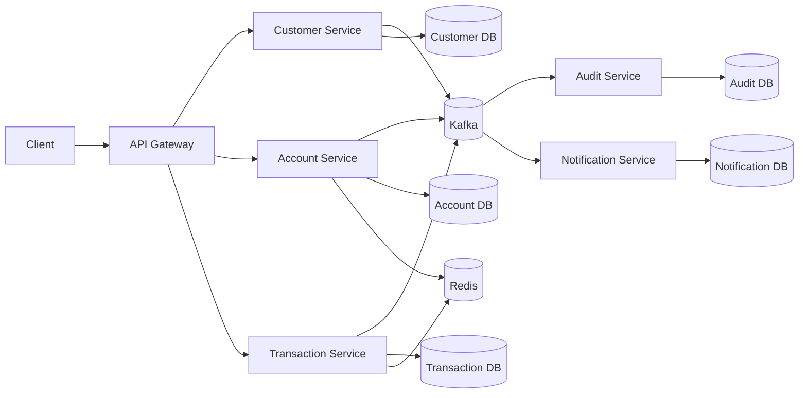

# System Architecture

## 1. Architecture Style

Hệ thống sử dụng:

- Microservices Architecture.
- Database-per-Service.
- REST synchronous communication.
- Kafka asynchronous event communication.
- Saga Pattern.
- Outbox Pattern.
- Redis.
- API Gateway.

## 2. Logical Architecture



## 3. Service Responsibilities

### API Gateway

MUST:

- Route request.
- Validate JWT.
- Add/propagate trace ID.
- Rate limiting.
- Hide internal service endpoints.

### Customer Service

MUST:

- CRUD customer.
- Manage customer status.
- Publish customer events.

Không quản lý account balance.

### Account Service

MUST:

- Create account.
- Manage account status.
- Read/update balance.
- Validate sufficient balance.
- Handle account-level concurrency.

### Transaction Service

MUST:

- Create transaction.
- Coordinate deposit.
- Coordinate withdrawal.
- Coordinate transfer.
- Track transaction state.
- Handle Saga state.

Không trực tiếp update account database.

### Audit Service

MUST:

- Store audit events.
- Preserve historical transaction changes.
- Support querying audit records.

### Notification Service

MUST:

- Consume business events.
- Send notification.
- Retry failed notification.

Không quyết định transaction success.

## 4. Communication

### Synchronous

REST dùng cho:

- Request/response cần ngay.
- Query.
- Command phù hợp với service boundary.

### Asynchronous

Kafka dùng cho:

- Business events.
- Audit.
- Notification.
- Saga events.
- Decoupled processing.

## 5. Distributed Transaction

Transfer không được thực hiện bằng distributed DB transaction.

Flow:

```text
Client
  ↓
Gateway
  ↓
Transaction Service
  ↓
Create PENDING transaction
  ↓
TransferCreated
  ↓
Kafka
  ↓
Account Service
  ↓
Debit Source
  ↓
Credit Target
  ↓
TransferCompleted
  ↓
Kafka
  ↓
Transaction Service
  ↓
SUCCESS
```

## 6. Failure Flow

```text
Debit Source SUCCESS
        ↓
Credit Target FAILED
        ↓
Compensation
        ↓
Credit Source
        ↓
Transaction REVERSED / FAILED
```

## 7. Non-Goals

MVP không yêu cầu:

- Core banking ledger hoàn chỉnh.
- Interest calculation.
- Loan management.
- Card management.
- FX trading.
- AML engine.
- Fraud engine.

Các chức năng này có thể mở rộng sau.
