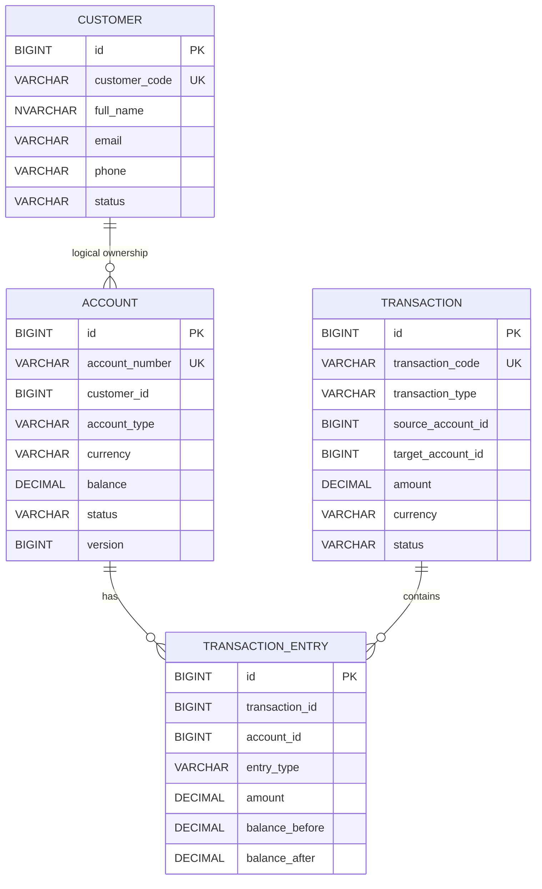

# Database Specification

## 1. Database Strategy

Database-per-service:

```text
customer_db
account_db
transaction_db
audit_db
notification_db
```

No cross-service physical FK.

## 2. Customer DB

### CUSTOMER

| Column | Type | Rule |
|---|---|---|
| id | BIGINT | PK |
| customer_code | VARCHAR(50) | UNIQUE |
| full_name | NVARCHAR(200) | NOT NULL |
| email | VARCHAR(200) | NULL |
| phone | VARCHAR(30) | NULL |
| status | VARCHAR(20) | NOT NULL |
| created_at | DATETIME2 | NOT NULL |
| updated_at | DATETIME2 | NOT NULL |

## 3. Account DB

### ACCOUNT

| Column | Type | Rule |
|---|---|---|
| id | BIGINT | PK |
| account_number | VARCHAR(50) | UNIQUE |
| customer_id | BIGINT | Logical reference only |
| account_type | VARCHAR(30) | NOT NULL |
| currency | VARCHAR(3) | NOT NULL |
| balance | DECIMAL(19,4) | NOT NULL |
| status | VARCHAR(20) | NOT NULL |
| version | BIGINT | Optimistic lock |
| created_at | DATETIME2 | NOT NULL |
| updated_at | DATETIME2 | NOT NULL |

### TRANSACTION_ENTRY

| Column | Type | Rule |
|---|---|---|
| id | BIGINT | PK |
| transaction_id | BIGINT | Logical transaction ID |
| account_id | BIGINT | Local account ID |
| entry_type | VARCHAR(20) | DEBIT/CREDIT |
| amount | DECIMAL(19,4) | NOT NULL |
| balance_before | DECIMAL(19,4) | NOT NULL |
| balance_after | DECIMAL(19,4) | NOT NULL |
| created_at | DATETIME2 | NOT NULL |

## 4. Transaction DB

### TRANSACTION

| Column | Type | Rule |
|---|---|---|
| id | BIGINT | PK |
| transaction_code | VARCHAR(50) | UNIQUE |
| transaction_type | VARCHAR(20) | NOT NULL |
| source_account_id | BIGINT | Logical reference |
| target_account_id | BIGINT | Logical reference |
| amount | DECIMAL(19,4) | NOT NULL |
| currency | VARCHAR(3) | NOT NULL |
| status | VARCHAR(20) | NOT NULL |
| description | NVARCHAR(500) | NULL |
| created_at | DATETIME2 | NOT NULL |
| completed_at | DATETIME2 | NULL |

### IDEMPOTENCY_REQUEST

Recommended persistent table for financial command idempotency.

| Column | Type |
|---|---|
| id | BIGINT |
| idempotency_key | VARCHAR(100) |
| request_hash | VARCHAR(128) |
| transaction_id | BIGINT |
| status | VARCHAR(20) |
| response_snapshot | NVARCHAR(MAX) |
| created_at | DATETIME2 |
| expires_at | DATETIME2 |

Unique constraint:

```text
(idempotency_key)
```

## 5. Audit DB

### AUDIT_LOG

| Column | Type |
|---|---|
| id | BIGINT |
| event_id | VARCHAR(100) |
| transaction_id | BIGINT |
| action | VARCHAR(100) |
| old_status | VARCHAR(30) |
| new_status | VARCHAR(30) |
| actor | VARCHAR(100) |
| message | NVARCHAR(1000) |
| created_at | DATETIME2 |

## 6. Outbox

Each service that publishes business events SHOULD own an outbox table.

### OUTBOX_EVENT

| Column | Type |
|---|---|
| id | BIGINT |
| event_id | VARCHAR(100) |
| aggregate_type | VARCHAR(100) |
| aggregate_id | VARCHAR(100) |
| event_type | VARCHAR(200) |
| payload | NVARCHAR(MAX) |
| status | VARCHAR(20) |
| retry_count | INT |
| created_at | DATETIME2 |
| published_at | DATETIME2 |

## 7. ERD



Note: Mermaid relationship between Customer and Account represents a logical business relationship, not a cross-database physical FK.
