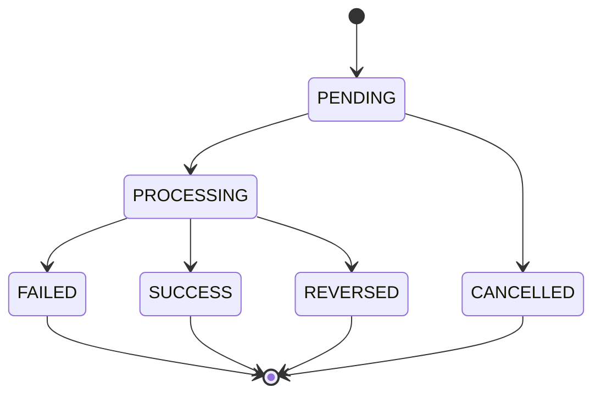

# Saga and Compensation Specification

## 1. Purpose

Saga coordinates a business transaction across multiple services without distributed database transaction.

## 2. Transfer Saga

Transfer participants:

- Transaction Service.
- Account Service.

Transaction Service is the Saga coordinator for the MVP.

## 3. State Machine



## 4. Happy Path

```text
1. Receive transfer request
2. Validate request
3. Check idempotency
4. Create transaction PENDING
5. Publish TransferCreated
6. Account Service processes debit/credit
7. Publish TransferCompleted
8. Transaction Service marks SUCCESS
```

## 5. Failure Path

Example:

```text
Debit Source = SUCCESS
Credit Target = FAILED
```

Compensation:

```text
Credit Source
```

Then:

```text
Transaction = REVERSED
```

## 6. Compensation Rules

### SAGA-001

Compensation MUST be idempotent.

### SAGA-002

Compensation MUST NOT create duplicate money.

### SAGA-003

A compensation operation needs its own unique command/event ID.

### SAGA-004

Original transaction must remain auditable.

## 7. Transfer Saga Record

Recommended fields:

```text
sagaId
transactionId
state
currentStep
sourceAccountId
targetAccountId
amount
retryCount
lastError
createdAt
updatedAt
```

## 8. Timeout

If Saga does not complete within configured timeout:

1. Mark processing state appropriately.
2. Retry if safe.
3. Trigger compensation when business conditions allow.
4. Record audit event.

Exact timeout values are deployment configuration and should not be hardcoded into business logic.

## 9. Important Constraint

Do NOT implement:

```java
@Transactional
```

across Transaction DB and Account DB.

Each service controls its own local transaction.
